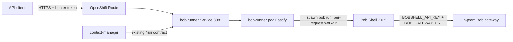

# Plan: Bob Shell as an invokable prompt API on OpenShift (warm runner)

## Top-Level Overview

**Goal:** Call an HTTPS endpoint on OpenShift with a prompt (plus optional mode) and get Bob Shell's result back in the HTTP response.

**Approach (confirmed with user):** Harden and expose the existing `bob-runner` Deployment. Do not build a per-request Kubernetes Job gateway.
- **Warm runner:** one long-lived Fastify pod spawns `bob run` for each request.
- **Synchronous only:** `POST /run` blocks until Bob finishes. Default timeout is 180s, a per-request override is allowed up to a cap, and the Route timeout is raised to match.
- **Response shape:** parsed JSON `{status, result, exitCode, durationMs}`. The existing `output` and `exitCode` fields stay for backward compatibility.
- **Additions:** a Route, bearer-token auth, a concurrency limit, per-request workspace dirs, mode validation, and the Bob 2.0.5 image.

**Non-goals:** async/run-id API, per-request pods or real Job objects, Redis/context-manager changes, the SRE multi-job demo, and moving off the on-prem Bob gateway.

### What already exists (from assessment)
- [`services/bob-runner/src/index.ts`](services/bob-runner/src/index.ts): Fastify with `GET /healthz` and `POST /run`. `POST /run` takes `{prompt, approvalMode, mode}`. CORS is `*`.
- [`services/bob-runner/src/executor.ts`](services/bob-runner/src/executor.ts): spawns `bob run <prompt> --mode <m> --trust --format json --max-turns 20`.
  - The environment sets `BOBSHELL_API_KEY`, `BOB_GATEWAY_URL`, `NODE_TLS_REJECT_UNAUTHORIZED=0`, `HOME=/bob-home` and `CI=true`.
  - It uses a single shared `cwd`, `/tmp/bob-workspace`.
  - The timeout is a 180s SIGTERM.
  - It returns raw `stdout || stderr` as `output`.
- [`services/bob-runner/Dockerfile`](services/bob-runner/Dockerfile): UBI9 + Node 22 + `container/bobshell-2.0.5.tgz`.
  - It bakes the custom modes (`instana`, `openshift-sre`, `infra-sre`) and a license-consent `settings.json` into `/bob-home`, which is chmod 777.
  - It runs as USER 1001.
  - `services/bob-runner/Containerfile` is an older variant that uses `bobshell-2.0.4.tgz`.
- [`manifests/bob-runner-buildconfig.yaml`](manifests/bob-runner-buildconfig.yaml): ImageStream + Git BuildConfig (`services/bob-runner/Dockerfile`, `main`), namespace `sre-demo`.
- [`k8s/04-bob-runner.yaml`](k8s/04-bob-runner.yaml): Deployment (1 replica, 200m/512Mi requests, 1 CPU/2Gi limits, `/healthz` readiness) + ClusterIP Service on 8081. It reads credentials from the `bob-credentials` Secret.
- [`services/context-manager/src/index.ts`](services/context-manager/src/index.ts) (~line 86): the only existing consumer of `POST /run`. It posts to `/run` and reads `output` and `exitCode`, with a 180s axios timeout. **Do not break this contract.**

### Gaps this plan closes
1. There is no external Route, and no auth or CORS restriction on the API.
2. The response is raw stdout, so callers get noise instead of a clean `result`.
3. There is no concurrency cap. Concurrent `bob run` processes share one cwd and can exceed the 2Gi pod limit.
4. The mode is not validated. The route schema types only 4 modes while the executor accepts 8. `approvalMode` is accepted but ignored.
5. The timeout path only sends SIGTERM and has no SIGKILL escalation. The rejected promise can leave child processes behind.
6. [`k8s/01-secrets.yaml`](k8s/01-secrets.yaml) contains a plaintext API key committed to git. There is also no API-token secret for the new endpoint.
7. A stale `services/bob-runner/bobshell-2.0.4.tgz` and `Containerfile` still reference 2.0.4. The `bob-runner` Deployment is not part of `deploy.sh`.
8. Route default timeout (30s) is shorter than Bob runs.

---

## Sub-Tasks

### Sub-Task 1 — Harden the executor (JSON result, per-request workspace, kill handling)
**Intent:** Make each run isolated, parseable, and safely terminable.

**Expected Outcomes:**
- Each request runs in its own temp directory that is removed afterwards. Concurrent runs do not share files.
- The response contains a parsed `result` (the final message from Bob's `--format json` output). If the output is not valid JSON, the raw text is returned in `result` and a flag marks it. `output` and `exitCode` are still present.
- On timeout, the process (group) gets SIGTERM, then SIGKILL after a grace period. The caller gets a clear timeout status, not a generic 500.
- `durationMs` is reported.

**Todo List:**
1. Confirm the exact shape of `bob run --format json` output (fields such as `last_message` and stats). Run `bob run` locally or from the image with a trivial prompt. The entrypoint comments mention "stats and last_message" but this has not been verified.
2. Create a unique workdir per request (under `BOB_WORKSPACE`), pass it as `cwd`, and delete it in a `finally` block.
3. Parse stdout JSON. Map it to `{status: success|failed|timeout, result, exitCode, durationMs, output}`. Keep `output` unchanged for context-manager.
4. Spawn with `detached` or process-group handling so SIGTERM and SIGKILL reach child tool processes. Make the timeout resolve to a typed result or error instead of an untyped rejection.
5. Honour the `approvalMode` parameter, or remove it from the contract. Decision needed: Bob already runs with `--trust`. Check which flag Bob 2.x supports (for example `--yolo`) before deciding.
6. Stop forcing `NODE_TLS_REJECT_UNAUTHORIZED=0` from code. Make it an env-configurable setting that defaults to 0 for the on-prem self-signed cert. Document it.

**Relevant Context:** [`services/bob-runner/src/executor.ts`](services/bob-runner/src/executor.ts), [`container/entrypoint.sh`](container/entrypoint.sh) (the working `bob run` invocation and flags).

**Status:** `[x] done`

---

### Sub-Task 2 — API surface: validation, auth, concurrency limit, timeout cap
**Intent:** Turn `POST /run` into a safe, documented, externally callable endpoint.

**Expected Outcomes:**
- `POST /run` accepts `{prompt, mode?, timeoutSeconds?}`. The prompt must be a non-empty string with a maximum length. The mode must be in an allow-list that matches the baked-in modes (`agent`, `code`, `ask`, `plan`, `advanced`, `instana`, `openshift-sre`, `infra-sre`). `timeoutSeconds` is capped by an env var (for example `MAX_TIMEOUT_SECONDS`).
- Requests need `Authorization: Bearer <token>`. The token comes from an env var backed by a Secret. `/healthz` stays open for probes.
- A semaphore limits concurrent runs (`MAX_CONCURRENT_RUNS`, default 2, based on the pod memory limit). Excess requests get `429` with `Retry-After` and are not queued. Queueing is rejected because a synchronous API would hold the Route connection open.
- Error contract: 400 invalid input, 401 unauthenticated, 429 busy, 504 timeout, 500 execution error. Each returns JSON.
- CORS is restricted by env var (off by default) instead of `*`.
- context-manager (which calls `/run` in-cluster) either keeps working through a documented option or gets the same token via env.

**Todo List:**
1. Add a Fastify JSON schema for the request and response.
2. Add an auth `onRequest` hook with a constant-time token compare, skipping `/healthz`.
3. Add the concurrency limiter and the 429 path.
4. Pick the context-manager approach: (a) pass the token from `bob-chat-config` or a Secret, or (b) allow unauthenticated in-cluster calls via a second internal port or a NetworkPolicy. Option (a) is the simplest. Update [`services/context-manager/src/index.ts`](services/context-manager/src/index.ts) to send the header and add the env var to [`k8s/02-configmap.yaml`](k8s/02-configmap.yaml) or a Secret ref. Keep this change minimal.
5. Keep the Fastify `bodyLimit` and the `connectionTimeout` / `requestTimeout` settings at least as long as the max run timeout. Node's HTTP server defaults can cut off long-running requests.
6. Log request metadata (mode, prompt length, duration, status). Never log the prompt in full or any secrets.

**Relevant Context:** [`services/bob-runner/src/index.ts`](services/bob-runner/src/index.ts), [`services/bob-runner/package.json`](services/bob-runner/package.json) (Fastify 4, `@fastify/cors`), [`services/context-manager/src/index.ts`](services/context-manager/src/index.ts).

**Status:** `[x] done`

---

### Sub-Task 3 — Image cleanup and build (Bob 2.0.5)
**Intent:** Ensure the image that gets deployed is the intended one: Bob 2.0.5, modes baked in, runnable under an arbitrary UID.

**Expected Outcomes:**
- Only `services/bob-runner/Dockerfile` (2.0.5) is the build source. The stale `Containerfile` and `bobshell-2.0.4.tgz` are removed, or explicitly justified if something references them.
- `oc start-build bob-runner` succeeds and produces `bob-runner:latest` in the `sre-demo` ImageStream.
- `bob --version` inside the image reports 2.0.5, and the pod starts under the restricted-v2 SCC with a random UID.
- Build source decision is documented. The BuildConfig uses the Git repo, so the build needs the latest commit to be pushed, **including** `container/bobshell-2.0.5.tgz` and `.bob/modes/`. Alternatively use a binary build with `--from-dir=.` as `deploy.sh` does for other images.

**Todo List:**
1. Check that nothing else references `Containerfile` or the 2.0.4 tarball (`grep`). Then delete them.
2. Confirm that `container/bobshell-2.0.5.tgz` is tracked in git (not ignored). `.gitignore` ignores `.bob/*` except `.bob/modes/**`, which is fine for the build.
3. Decide Git vs binary build and align the BuildConfig (and `deploy.sh`, see Sub-Task 5).
4. Check the `writable HOME` under a random UID: Bob needs `/bob-home/.bob` writable. The Dockerfile already does `chmod -R 777`. Verify in the cluster.
5. Build and push the image. Confirm the result with `oc logs build/...`.

**Relevant Context:** [`services/bob-runner/Dockerfile`](services/bob-runner/Dockerfile), [`manifests/bob-runner-buildconfig.yaml`](manifests/bob-runner-buildconfig.yaml), [`container/Dockerfile`](container/Dockerfile) (reference pattern), [`.gitignore`](.gitignore).

**Status:** `[x] done`

---

### Sub-Task 4 — OpenShift manifests: Secret, Deployment, Service, Route
**Intent:** Deploy the hardened runner and expose it securely with timeouts that fit long Bob runs.

**Expected Outcomes:**
- Credentials come from Secrets that are **not** committed with real values: `bob-credentials` (`BOBSHELL_API_KEY`, `BOB_GATEWAY_URL`) and a new API-token Secret (for example `bob-runner-api` with `API_TOKEN`). Committed files hold placeholders only, or are replaced by an `oc create secret` command in docs.
- The Deployment sets `MAX_CONCURRENT_RUNS`, `MAX_TIMEOUT_SECONDS` and the Secret env refs. It adds a liveness probe, uses `emptyDir` for the workspace (`/tmp/bob-workspace`), and sets `terminationGracePeriodSeconds` greater than the max run time so in-flight requests can finish on rollout (or documents that they will be cut).
- A new edge-TLS Route targets the Service and carries `haproxy.router.openshift.io/timeout` set above the max run time (default Route timeout is 30s).
- The pod runs with `runAsNonRoot`, no privilege escalation, dropped capabilities and `seccompProfile: RuntimeDefault`. These match the existing `k8s/job/02-bob-test-job.yaml` pattern.
- Single replica by default. Document that scaling out multiplies the concurrency limit and that limits are per pod.

**Todo List:**
1. Replace the real API key in [`k8s/01-secrets.yaml`](k8s/01-secrets.yaml) with a placeholder. **The key is already in git history and is exposed, so recommend rotating it.** Add a Secret manifest or an `oc create secret` command for the API token.
2. Update [`k8s/04-bob-runner.yaml`](k8s/04-bob-runner.yaml): the env vars above, the security context, liveness probe, `emptyDir`, resource sizing (check against `MAX_CONCURRENT_RUNS` × per-run memory), and `terminationGracePeriodSeconds`.
3. Add a new Route manifest (in a new file such as `k8s/06-bob-runner-route.yaml`) with edge TLS, redirect for insecure traffic, and the timeout annotation.
4. Confirm the namespace. Manifests use `sre-demo` for the image path. Decide whether this API lives there or in its own namespace (see Open Questions).
5. Optional hardening: a NetworkPolicy restricting ingress to the router and context-manager.

**Relevant Context:** [`k8s/04-bob-runner.yaml`](k8s/04-bob-runner.yaml), [`k8s/05-context-manager-route.yaml`](k8s/05-context-manager-route.yaml) (Route pattern), [`k8s/02-configmap.yaml`](k8s/02-configmap.yaml), [`k8s/job/02-bob-test-job.yaml`](k8s/job/02-bob-test-job.yaml) (security context pattern).

**Status:** `[x] done`

---

### Sub-Task 5 — Deploy script and end-to-end verification
**Intent:** Make the deployment repeatable and prove the API works from outside the cluster.

**Expected Outcomes:**
- A documented, repeatable sequence (or a small script, extending [`deploy.sh`](deploy.sh) or a separate `deploy-bob-api.sh`) that: logs in, applies the BuildConfig, builds, creates Secrets, applies the Deployment/Service/Route and prints the Route URL.
- `deploy.sh` and any new script read the OCP token from the environment, not from hard-coded values. `deploy.sh` currently contains a hard-coded token and server. Do not copy that pattern.
- Verified with curl: a valid call returns `{status:"success", result:...}`, and the existing context-manager chat flow still works.
- Negative tests pass: no token gives 401, bad mode gives 400, over-limit concurrency gives 429, and a tiny `timeoutSeconds` gives 504 with the child process gone.

**Todo List:**
1. Write the deploy steps (login, `oc apply` for build resources, `oc start-build`, secrets, manifests, rollout status).
2. Smoke test: `curl -H "Authorization: Bearer $TOKEN" -d '{"prompt":"Say hello in one sentence. Do not use any tools."}' https://<route>/run` (prompt text taken from [`bob-shell-instana-sre-demo-plan.md`](bob-shell-instana-sre-demo-plan.md)).
3. Verify reachability from the pod to the on-prem gateway, so connectivity problems are separated from application problems.
4. Run the negative tests above, plus 3 concurrent calls with `MAX_CONCURRENT_RUNS=2`.
5. Regression check: send a chat through context-manager's `/api/chat`.
6. Write a short usage section (a README or a section appended to this plan): endpoint, headers, body, response, error codes, limits.

**Relevant Context:** [`deploy.sh`](deploy.sh), [`manifests/run-demo.sh`](manifests/run-demo.sh), [`bob-shell-job-plan.md`](bob-shell-job-plan.md) (earlier connectivity validation notes).

**Status:** `[x] done`

---

## Open Questions / Risks
- **Namespace and cluster:** the repo hard-codes `sre-demo` on the Sydney cluster with the Bob gateway on the Tokyo on-prem cluster. Confirm the target cluster and namespace. Also confirm that `oc` access is available.
- **Exposed credential:** the Bob API key in `k8s/01-secrets.yaml` (and the OCP token in `deploy.sh`) are in the repo and in git history. Rotate both. They are out of scope to fix beyond placeholders.
- **No per-request pod isolation (accepted trade-off):** Bob runs with `--trust` and the modes have the `execute` group, so a prompt can run shell commands inside the shared runner pod. The Secret env vars are visible to those commands. The bearer token plus a restricted-audience Route are therefore the main control. Treat callers as trusted.
- **Capacity:** the pod has 2Gi memory. The right `MAX_CONCURRENT_RUNS` should be measured, not guessed (Sub-Task 5).
- **Long runs through the Route:** the Route timeout annotation and any upstream proxy or client timeouts must all exceed the run timeout. Default is 180s, so keep the cap modest.
- **`--format json` output shape:** unverified, and Sub-Task 1 depends on it (step 1).

---

## Orchestrate integration (done)

- `orchestrate/bob-runner-openapi.yaml`: OpenAPI tool for `POST /run`, bearer connection `bob_runner_api`.
- `orchestrate/bob_prompt_agent.yaml`: drafts the Bob prompt, asks clarifying questions, asks for confirmation, then calls the runner.
- `orchestrate/ibm_docs_rag_agent_v1.yaml`: `bob_prompt_agent` added as a collaborator, so Slack users of `ibm_docs_rag_agent_v1` can use Bob.
- Import with `orchestrate agents import -f <file>`. Create the connection and set the runner token first (see the Orchestrate CLI docs); never commit the token.
