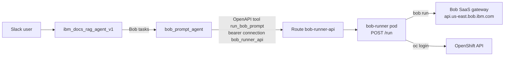

# Bob Runner on OpenShift + Orchestrate: Notes

Bob Shell runs on OpenShift behind a small HTTP API. A watsonx Orchestrate agent turns requests into good Bob prompts, calls the API, and is reachable from Slack through `ibm_docs_rag_agent_v1`.

No secret values are in this file or in git. See "Secrets" for where they live.

## Architecture



## Components

| Component | Where | Notes |
|---|---|---|
| Bob runner API | namespace `sre-demo`, Deployment `bob-runner` | Node service in `services/bob-runner`. Runs `bob run --format json`. |
| Route | `bob-runner-api-sre-demo.apps.itz-io8qfw.infra01-lb.lon04.techzone.ibm.com` | Edge TLS, 660 s timeout (must exceed the 600 s run cap). |
| Orchestrate tool | `orchestrate/bob-runner-openapi.yaml` | Operation `run_bob_prompt`. Orchestrate shows it as `run_a_prompt_with_bob_shell`. |
| Orchestrate agent | `orchestrate/bob_prompt_agent.yaml` | Prompt engineer. Never answers the task itself. |
| Entry agent | `orchestrate/ibm_docs_rag_agent_v1.yaml` | Docs questions stay with its own tools. Bob tasks go to `bob_prompt_agent`. |

## Runner API

- `GET /healthz`: no auth.
- `POST /run`: `Authorization: Bearer <API_TOKEN>`.

Request:

```json
{ "prompt": "string", "mode": "ask", "timeoutSeconds": 180 }
```

Response: `{ status, result, rawOutput, output, exitCode, durationMs }`.
`result` comes from the `last_message` field of Bob's JSON output.

| Code | Meaning |
|---|---|
| 200 | Run finished. Check `status` (`success`, `failed`, `timeout`). |
| 400 | Invalid request. |
| 401 | Missing or wrong bearer token. |
| 429 | Busy. Limit is 2 concurrent runs. |
| 504 | Run timed out. |

Defaults: 180 s timeout, 600 s maximum. Each run gets a fresh empty workspace (emptyDir) that is removed afterwards.

Modes: `ask`, `plan`, `code`, `agent`, `advanced`, plus the custom `instana`, `openshift-sre` and `infra-sre`. Use the least powerful mode that fits.

## Authentication

### Bob Shell to the Bob gateway

- Per the Bob docs, `bob run` needs an API key in the `BOB_API_KEY` environment variable. Interactive SSO or IBMid tokens from `bob chat` are not reused for non-interactive runs.
- Create the key in the Bob web portal with **Scope = Inference**. A key of type **general** also needs `--team-id <team-id>`.
- Our manifests set `BOBSHELL_API_KEY` and `BOB_GATEWAY_URL`. This works with Bob 2.0.5. The docs I found only name `BOB_API_KEY`, so add that env name too if you want the documented one.
- Gateway in use: `https://api.us-east.bob.ibm.com`. `api.eu-de.bob.ibm.com` also worked. The old on-prem Tokyo gateway returned 503 and was dropped.

### Bob Shell to OpenShift

- `openshift-sre` mode expects `OCP_TOKEN` and `OCP_API_URL` env vars and runs `oc login --token=$OCP_TOKEN --server=$OCP_API_URL`.
- The image now includes `oc` and `kubectl` (`services/bob-runner/Dockerfile`).
- The Deployment loads the optional Secret `ocp-credentials` through `envFrom`.
- The token currently in that Secret is the `kube:admin` token, which is full cluster-admin and expires. Bob can run destructive commands with it.
- Safer option: a ServiceAccount with the `view` role and its token in the same Secret.
- Never put the token in a prompt. `bob_prompt_agent` refuses prompts containing secrets. Tell Bob to read the env vars instead.

### Orchestrate to the runner

- Connection `bob_runner_api` (bearer, team scope), set for both draft and live. The value is the runner `API_TOKEN`.

## Secrets

| Secret (namespace `sre-demo`) | Keys | Source |
|---|---|---|
| `bob-credentials` | `BOBSHELL_API_KEY`, `BOB_GATEWAY_URL` | Bob portal API key |
| `bob-runner-api` | `API_TOKEN` | Generated for the runner |
| `ocp-credentials` | `OCP_TOKEN`, `OCP_API_URL` | `oc login` token |

Repo rules:
- Real secret files are git-ignored. Only `*.example.yaml` templates are tracked.
- `deploy.sh` requires `OCP_TOKEN` in the environment.
- History was rewritten with `git filter-repo` and force-pushed. A fresh clone has no leaked values.

Read the runner token when needed:

```bash
oc get secret bob-runner-api -n sre-demo -o jsonpath='{.data.API_TOKEN}' | base64 -d
```

Refresh the OCP token when it expires:

```bash
oc create secret generic ocp-credentials -n sre-demo \
  --from-literal=OCP_TOKEN="<new token>" --from-literal=OCP_API_URL="<api url>" \
  --dry-run=client -o yaml | oc apply -f -
oc rollout restart deploy/bob-runner -n sre-demo
```

## Build and deploy

```bash
# Build (binary build, run from agentic-sre/)
oc start-build bob-runner -n sre-demo --from-dir=. --follow

# Deploy
oc apply -f k8s/04-bob-runner.yaml -n sre-demo
oc rollout status deploy/bob-runner -n sre-demo
```

Manifests: `k8s/04-bob-runner.yaml` (Deployment, Service, Route) and `manifests/bob-runner-buildconfig.yaml`. Security context: non-root, seccomp RuntimeDefault, all capabilities dropped. Probes use `/healthz`.

## Orchestrate setup

Needs the ADK CLI (`orchestrate`, tested with 2.18.2).

```bash
orchestrate env activate <env> --api-key "<key>"
# create connection bob_runner_api (bearer), set the runner token for draft and live
orchestrate tools import -k openapi -f orchestrate/bob-runner-openapi.yaml
orchestrate agents import -f orchestrate/bob_prompt_agent.yaml
orchestrate agents import -f orchestrate/ibm_docs_rag_agent_v1.yaml
```

Gotchas:
- Strip trailing CR/whitespace from the API key read from an env file: `tr -d '\r\n \t"'`.
- `orchestrate chat ask` needs the local developer edition. Use the REST runs API (`/v1/orchestrate/runs`) to test.
- Only one `byo_slack` channel is allowed per environment. The RAG agent has one in the draft environment. The live environment has none.
- Slack needs the `channel` context variable, enabled on both agents.
- The RAG agent's original guidelines trigger a "guideline conflict" import warning. It is not caused by the Bob changes.
- `bob_prompt_agent` has no `guidelines:` block for the same reason. Its rules are in the instructions.

## Agent behaviour

`bob_prompt_agent` flow:
1. Check the request for gaps (goal, input, scope, output, constraints, success criteria, risk). Ask at most 4 questions.
2. Pick the least powerful mode.
3. Draft the prompt and ask "Run this with Bob? (yes / change something)". It does not run before the user confirms.
4. Call the runner and report the result. Handle 504, 429, 401 and failed runs with a plain explanation and one retry offer.

Delegation fix: the RAG agent first reworded the collaborator's replies and sometimes answered Bob tasks itself, labelling the answer as Bob's. Fixed by strict rules in item 6 of its instructions (always delegate, pass messages word for word, copy replies word for word) and by exempting Bob replies from the documentation answer format in item 2.

## Test results

- Runner through the Route: success, a tool-use call, a 504 timeout, and 429 under concurrency (2 of 4 parallel requests rejected).
- `bob_prompt_agent` directly: vague request gave clarifying questions with no tool call; complete request gave a draft plus confirmation; "yes" ran Bob; a request containing a secret was refused.
- Through `ibm_docs_rag_agent_v1`: three full runs (request, then "yes"). Each showed the draft first, and each "yes" produced a runner log entry with `mode: ask`, 6 to 8 s. One of the three returned `failed` ("Unexpected error: terminated") from the runner. The cause is not known and a retry worked.
- `openshift-sre` mode: Bob logged in with `oc` and listed pods in `sre-demo`, 16 s.
- Not yet tested: Slack.

## Open items

- Rotate the credentials that were exposed in the old git history: the old on-prem Bob key, the Instana token and the OCP tokens. Old commit SHAs may still be cached on GitHub.
- Replace the `kube:admin` token with a least-privilege ServiceAccount token.
- Test from the draft Slack channel. Deploy to the live environment if production use is wanted.
- Find out why one run failed with "terminated".
- Delete `/tmp/agentic-sre-backup` (pre-rewrite backup that still holds old secrets).
- Optional: commit the two untracked `package-lock.json` files.
